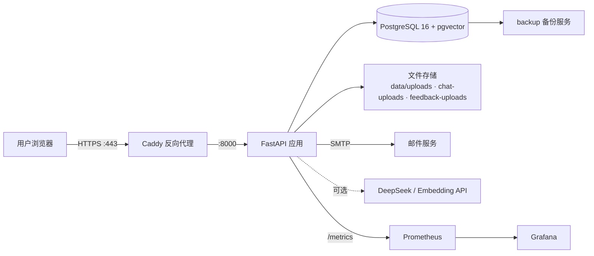

# 燕渡 YanDu

旧物渡新主，学海渡轻舟。

燕渡是一个面向北大校园的二手交易平台：发布闲置、浏览好物、自然语言搜索、买家代蹲、站内聊天与完整交易状态流转，开箱即用，并配套 PostgreSQL + pgvector、HTTPS、监控与备份的部署能力。

[](https://github.com/QiWang3569/yandu/actions/workflows/checks.yml)
[](https://www.python.org/)
[](https://fastapi.tiangolo.com/)
[](https://nodejs.org/)
[](https://react.dev/)
[](https://www.postgresql.org/)
[](#测试与覆盖率)
[](#测试与覆盖率)

> 本仓库已转为公开（public）。请勿把本地 `.env`、数据库、图片或密钥提交到仓库。

## 项目简介

燕渡由前后端分离的 Web 应用构成：后端为 FastAPI + SQLAlchemy 2.0，前端为 React 19 + TypeScript + Vite。默认使用 SQLite 与本地规则解析，无需任何模型密钥即可零配置运行；生产环境切换到 PostgreSQL 16 + pgvector，并通过 Caddy 提供 HTTPS，由 Prometheus + Grafana 提供可观测性。

核心亮点：

- 校园邮箱验证码与密码登录（仅接受 `@pku.edu.cn` / `@stu.pku.edu.cn`）。
- 登录会话闲置 7 天过期，前台操作时自动续期，最长 30 天需重新登录；后台轮询不续期，退出或重置密码撤销会话。
- 商品发布（0–9 张图片、自然语言智能识别填充）。
- 批量发布：按行批量导入商品描述，先存为仅本人可见的待发布草稿，核对后再逐件发布，便于把既有闲置批量迁移上平台。
- 分类 / 关键词 / 校区 / 价格 / 成色筛选、排序、收藏、三件对比与分享链接。
- 顶栏「智能」搜索：一句话解析出分类、预算、成色、关键词并返回结果。
- 买家代蹲：条件解析、持久化后台匹配、模型精筛、去重通知，服务重启后恢复任务。
- 求购看板与代蹲联动，商品 / 求购 / 代蹲持续有效，无自动到期。
- 站内文字 / 图片聊天、交易状态机、拉黑、消息举报与管理员审核。
- 站内意见反馈：提交问题与截图，管理员回复并更新状态，结果通过站内通知送达。
- 未读站内信邮件提醒（默认延迟 5 分钟并合并同一会话）。
- 管理员工作台：公告管理、用户反馈、聊天 / 商品举报、操作记录审计，以及商业指标与访客分析看板。
- 友好的人机交互：明暗双主题、响应式移动端布局、紧凑的首屏市场，以及清晰的加载 / 空状态 / 表单校验提示。

## 技术栈

| 层 | 技术 |
| --- | --- |
| 后端 | Python 3.12、FastAPI、SQLAlchemy 2.0、Uvicorn |
| 前端 | React 19、TypeScript 5.8、Vite 6 |
| 数据库 | SQLite（演示）/ PostgreSQL 16 + pgvector |
| 模型 | 本地规则解析（默认）或 DeepSeek 兼容接口 + Embedding API |
| 监控 | Prometheus（`prometheus-fastapi-instrumentator`）+ Grafana |
| 反向代理 | Caddy（自动 HTTPS） |
| 备份 | PostgreSQL 自定义格式每日备份 |

## 架构



## 功能特性

### 账号与安全

- 北大邮箱验证码注册、登录，注册时设置密码；邮箱 + 密码登录；验证邮箱后重置密码。
- 密码使用加盐 `scrypt` 摘要存储；登录限流、验证码频率限制、HttpOnly / SameSite Cookie 与来源校验。
- 会话闲置 7 天过期、最长 30 天；前台操作续期，退出或重置密码立即撤销。
- 演示模式提供林同学（买家）、许同学（卖家）、管理员三个本地身份，`DEMO_MODE=false` 时彻底关闭。

### 商品与搜索

- 发布、编辑和草稿最多 9 张图片，每张不超过 6 MB；支持自然语言智能识别填充与按行批量导入待发布草稿。
- 分类、关键词、校区、价格、成色筛选与排序分页；收藏分类与同校区优先的基础推荐。
- 智能搜索将自然语言解析为分类、预算、成色、关键词，支持“左右/大约”等约数价格。
- 商品撤回、成交后「再发一件」、待确认收货禁止重新上架。

### 买家代蹲与求购

- 必须条件、排除项、偏好三组解析；本地关键词召回或远程模型精筛，并给出匹配理由与待确认问题。
- 后台任务持久化、自动重试、手动重试、重启恢复；通知去重与已读状态。
- 发布求购自动关联代蹲，修改 / 暂停 / 结束状态双向同步；私密代蹲可发布到公开看板。

### 站内聊天、反馈与交易

- 买家主动发起会话，支持文字、图片与图文消息，未读提示与历史分页。
- 交易状态机：申请预订 → 确认 / 拒绝 → 售出 → 确认收货；拉黑与消息举报。
- 未读站内信邮件提醒，延迟 5 分钟合并发送，并保留投递队列与重试记录。
- 站内意见反馈支持问题与截图、我的反馈与补充；管理员回复并更新状态，结果通过站内通知送达。

### 治理与数据

- 管理员工作台：公告管理、用户反馈、聊天举报、商品举报、操作记录；文字风险词与同名商品线索。
- 公告统一从消息铃铛查看，登录用户仅把实际展示的公告标为已读。
- 商业指标看板：用户增长、访客漏斗、GMV、动销率、停留时长与犹豫商品。
- Prometheus 导出应用指标与自定义业务指标（活跃用户、会话、GMV、停留时长等）。

## 快速开始

### 环境要求

- Python 3.12
- Node.js 22
- （可选）Docker，用于 PostgreSQL / pgvector 与生产部署

### 获取代码

```shell
git clone https://github.com/QiWang3569/yandu.git
cd yandu
```

### Windows

```powershell
.\scripts\setup.ps1
.\scripts\start.ps1 -SkipBuild
```

打开 [http://127.0.0.1:8000](http://127.0.0.1:8000)。若 Python 不在 PATH，可运行 `.\scripts\setup.ps1 -Python '完整的 python.exe 路径'`。

停止服务（保留数据）：

```powershell
.\scripts\stop.ps1
```

### Linux / macOS

```sh
python3.12 -m venv .venv
.venv/bin/python -m pip install -r backend/requirements.lock.txt
cd frontend && npm ci && npm run build && cd ..
.venv/bin/python -m uvicorn app.main:app --app-dir backend --host 127.0.0.1 --port 8000
```

### 开发模式

先停止后台服务，避免占用端口。一个终端运行前端：

```sh
cd frontend
npm run dev
```

另一个终端运行后端：

```powershell
.\.venv\Scripts\python.exe -m uvicorn app.main:app --app-dir backend --host 127.0.0.1 --port 8000 --reload
```

开发页面 [http://127.0.0.1:5173](http://127.0.0.1:5173)，接口文档 [http://127.0.0.1:8000/docs](http://127.0.0.1:8000/docs)。

## 配置

复制 `.env.example` 为 `.env`。常用变量：

| 变量 | 默认值 | 说明 |
| --- | --- | --- |
| `DEMO_MODE` | `true` | 是否启用演示账号与种子数据 |
| `APP_ENV` | `local` | `local` 或 `production` |
| `DATABASE_URL` | `sqlite:///./data/yandu.db` | SQLite 或 PostgreSQL 连接串 |
| `AI_MODE` / `EMBEDDING_MODE` | `local` | `local` 或 `remote`，决定是否调用模型 / 向量接口 |
| `DEEPSEEK_API_KEY` 等 | 空 | 远程模型配置，支持兼容 `/chat/completions` 的服务 |
| `SMTP_HOST` / `SMTP_USER` / `SMTP_FROM` 等 | 空 | 验证码与邮件提醒所需 |
| `CHAT_EMAIL_ENABLED` | `false` | 未读站内信邮件提醒总开关 |
| `PUBLIC_APP_URL` | 空 | 邮件链接使用的站点来源 |
| `ALLOWED_ORIGINS` | 本地地址 | 允许的跨域来源 |
| `POSTGRES_PASSWORD` / `SITE_DOMAIN` | 空 | Docker / 生产部署所需 |

完整说明见 [docs/EMAIL_AND_CHAT.md](docs/EMAIL_AND_CHAT.md)、[docs/POSTGRESQL.md](docs/POSTGRESQL.md) 与 `.env.example` 注释。

## 测试与覆盖率

后端测试使用 pytest，覆盖业务流程、权限、迁移升级与外部服务替身：

```powershell
.\.venv\Scripts\python.exe -m pytest backend/tests -q
```

生成覆盖率报告：

```powershell
.\.venv\Scripts\python.exe -m pytest backend/tests -q --cov=app --cov-report=term-missing
```

前端类型检查与生产构建：

```sh
cd frontend
npm ci
npm run build
```

最新一次本地运行：210 项测试全部通过，整体行覆盖率 93%。GitHub Actions 会在推送与合并请求时，分别在 Windows 与 Linux 上执行后端测试和前端构建，结果见 [Actions](https://github.com/QiWang3569/yandu/actions)。

## 部署

生产环境使用 PostgreSQL + pgvector、Caddy HTTPS、每日数据库备份与安全 Cookie，编排见 [compose.production.yaml](compose.production.yaml)。先按 [docs/DEPLOYMENT.md](docs/DEPLOYMENT.md) 准备 `.env` 与站点域名，再启动：

```sh
docker compose -f compose.production.yaml up -d --build
```

带 Prometheus + Grafana 的预览编排见 [compose.preview.yaml](compose.preview.yaml)。服务器发布基线、回退与备份证据见 [docs/DEPLOYMENT_CURRENT.md](docs/DEPLOYMENT_CURRENT.md)。

## 目录结构

```text
backend/app/            FastAPI 应用：API、数据库、解析与匹配服务
backend/tests/          业务流程与权限测试（pytest）
frontend/src/           React + TypeScript 界面
scripts/                安装、启动、停止与备份脚本
docs/                   需求、实现、部署与验证文档
compose.yaml            本机 PostgreSQL、应用与备份
compose.production.yaml 生产编排（Caddy HTTPS）
compose.preview.yaml    带 Prometheus + Grafana 的预览编排
prometheus.yml          Prometheus 抓取配置
Caddyfile               Caddy 站点配置
data/                   数据库、图片、日志（不提交）
```

## 文档索引

- [需求与实现记录](docs/IMPLEMENTATION.md)
- [公开部署说明](docs/DEPLOYMENT.md) / [当前部署记录](docs/DEPLOYMENT_CURRENT.md)
- [PostgreSQL 接入与迁移](docs/POSTGRESQL.md)
- [邮箱登录与站内聊天](docs/EMAIL_AND_CHAT.md)
- [买家助手说明](docs/BUYER_AGENT.md)
- [站内意见反馈](docs/FEEDBACK.md)
- [修改日志](docs/CHANGELOG.md) / [验证记录](docs/VALIDATION.md)

## 许可证与贡献

本项目暂未随附开源许可证，代码使用需联系仓库所有者授权；请勿把本地 `.env`、数据库、图片或密钥提交到仓库。
