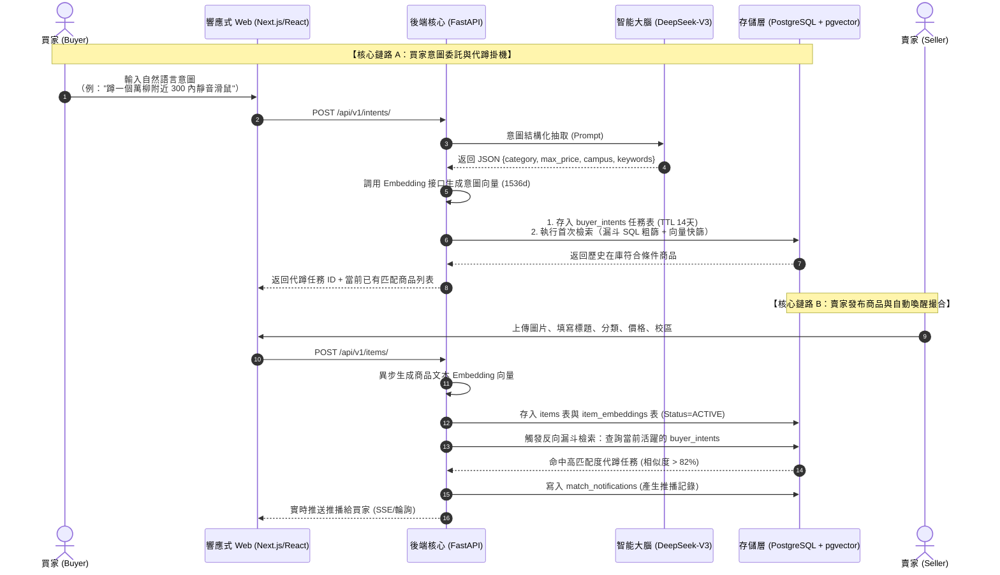

# 「燕渡」校園二手交易智能體——技術架構與實現規格書 (Technical Spec)
## Release v1.0 核心骨幹最小閉環版 (P0 MVP)

> **目標受眾**：全端研發團隊、AI Coding Agents  
> **發布目標**：下週上線核心 MVP（發布商品 $\to$ 瀏覽搜尋 $\to$ 自然語言意圖代蹲 $\to$ 漏斗向量撮合 $\to$ 命中推播）  
> **核心設計原則**：骨幹先行、規格確定、代碼與 DDL 可直接複製運行。

---

## 0. 系統端到端核心數據流 (Tracer Bullet Architecture)



---

## 1. 模組一：數據基座與存儲規格 (Database & Storage Schema)

### 1.1 PostgreSQL 擴展與枚舉定義
```sql
-- 啟用 UUID 與 向量擴展
CREATE EXTENSION IF NOT EXISTS "uuid-ossp";
CREATE EXTENSION IF NOT EXISTS "vector";

-- 商品狀態枚舉
CREATE TYPE item_status_enum AS ENUM ('ACTIVE', 'RESERVED', 'SOLD', 'EXPIRED');

-- 代蹲任務狀態枚舉
CREATE TYPE intent_status_enum AS ENUM ('ACTIVE', 'PAUSED', 'COMPLETED', 'EXPIRED');

-- 校區枚舉
CREATE TYPE campus_enum AS ENUM ('燕園校本部', '萬柳學區', '醫學部', '昌平新校區', '不限校區');
```

### 1.2 核心表結構 DDL

```sql
-- 1. 用戶表 (核心認證實體)
CREATE TABLE users (
    id UUID PRIMARY KEY DEFAULT uuid_generate_v4(),
    student_id VARCHAR(32) NOT NULL UNIQUE,       -- 學號/教工號 (唯一標識)
    nickname VARCHAR(50) NOT NULL,                -- 暱稱
    campus campus_enum NOT NULL DEFAULT '燕園校本部',
    department VARCHAR(50),                       -- 院系
    contact_wechat VARCHAR(50),                   -- 微信聯絡方式
    contact_phone VARCHAR(20),                    -- 電話聯絡方式
    created_at TIMESTAMP WITH TIME ZONE DEFAULT CURRENT_TIMESTAMP,
    updated_at TIMESTAMP WITH TIME ZONE DEFAULT CURRENT_TIMESTAMP
);

-- 2. 商品主表 (Relational Metadata)
CREATE TABLE items (
    id UUID PRIMARY KEY DEFAULT uuid_generate_v4(),
    seller_id UUID NOT NULL REFERENCES users(id) ON DELETE CASCADE,
    title VARCHAR(120) NOT NULL,                  -- 商品標題
    description TEXT,                             -- 商品詳細描述
    category VARCHAR(50) NOT NULL,                -- 一級分類 (課程資料/數位3C/校園出行/宿舍電器/生活美妝)
    tags TEXT[] DEFAULT '{}',                     -- 二級標籤數組 (如 ['滑鼠', '無線'])
    price NUMERIC(10, 2) NOT NULL CHECK (price >= 0),
    campus campus_enum NOT NULL DEFAULT '燕園校本部',
    condition_grade VARCHAR(20) NOT NULL DEFAULT '95新', -- 全新/95新/9成新/堪用
    images TEXT[] DEFAULT '{}',                   -- 圖片 URL 數組 (前台可上傳 1~3 張)
    status item_status_enum NOT NULL DEFAULT 'ACTIVE',
    created_at TIMESTAMP WITH TIME ZONE DEFAULT CURRENT_TIMESTAMP,
    expires_at TIMESTAMP WITH TIME ZONE DEFAULT (CURRENT_TIMESTAMP + INTERVAL '14 days')
);

CREATE INDEX idx_items_category_price ON items(category, price);
CREATE INDEX idx_items_status_campus ON items(status, campus);
CREATE INDEX idx_items_created_at ON items(created_at DESC);

-- 3. 商品向量表 (pgvector 稠密向量)
CREATE TABLE item_embeddings (
    item_id UUID PRIMARY KEY REFERENCES items(id) ON DELETE CASCADE,
    embedding vector(1536) NOT NULL,              -- 1536 維向量 (推薦 text-embedding-3-small 或等價)
    updated_at TIMESTAMP WITH TIME ZONE DEFAULT CURRENT_TIMESTAMP
);

-- 建立 HNSW 餘弦相似度索引 (極致查詢速度，內存充足下推薦)
CREATE INDEX idx_item_embeddings_hnsw ON item_embeddings 
USING hnsw (embedding vector_cosine_ops)
WITH (m = 16, ef_construction = 64);

-- 4. 買家意圖代蹲任務表 (Buyer Intents)
CREATE TABLE buyer_intents (
    id UUID PRIMARY KEY DEFAULT uuid_generate_v4(),
    buyer_id UUID NOT NULL REFERENCES users(id) ON DELETE CASCADE,
    raw_query TEXT NOT NULL,                      -- 買家原始自然語言 (例："蹲萬柳300內自習室靜音滑鼠")
    parsed_category VARCHAR(50),                  -- 抽取：品類
    parsed_max_price NUMERIC(10, 2),              -- 抽取：硬性最高預算
    parsed_campus campus_enum DEFAULT '不限校區',  -- 抽取：期望校區約束
    parsed_keywords TEXT,                         -- 抽取：核心語意關鍵字
    query_embedding vector(1536) NOT NULL,        -- 意圖語意向量
    status intent_status_enum NOT NULL DEFAULT 'ACTIVE',
    match_count INT DEFAULT 0,                    -- 已累計命中次數
    expires_at TIMESTAMP WITH TIME ZONE DEFAULT (CURRENT_TIMESTAMP + INTERVAL '14 days'),
    created_at TIMESTAMP WITH TIME ZONE DEFAULT CURRENT_TIMESTAMP
);

CREATE INDEX idx_buyer_intents_active ON buyer_intents(status, expires_at);

-- 5. 命中推播日誌表 (Notifications)
CREATE TABLE match_notifications (
    id UUID PRIMARY KEY DEFAULT uuid_generate_v4(),
    buyer_id UUID NOT NULL REFERENCES users(id) ON DELETE CASCADE,
    intent_id UUID NOT NULL REFERENCES buyer_intents(id) ON DELETE CASCADE,
    item_id UUID NOT NULL REFERENCES items(id) ON DELETE CASCADE,
    similarity_score NUMERIC(5, 4) NOT NULL,      -- 餘弦相似度 (如 0.8850)
    match_reason TEXT,                            -- 撮合亮點簡述 (Agent 總結)
    is_read BOOLEAN NOT NULL DEFAULT FALSE,
    created_at TIMESTAMP WITH TIME ZONE DEFAULT CURRENT_TIMESTAMP,
    CONSTRAINT uq_intent_item UNIQUE(intent_id, item_id) -- 防重複對同一任務推播同一商品
);

CREATE INDEX idx_notifications_buyer_unread ON match_notifications(buyer_id, is_read, created_at DESC);
```

---

## 2. 模組二：核心 RESTful API 規格 (FastAPI 實現標準)

所有接口路由統一前綴為 `/api/v1`，遵循標準 HTTP 狀態碼與 JSON 響應封裝。

### 2.1 數據傳輸模型 (Pydantic Models)

```python
# app/schemas/item.py
from pydantic import BaseModel, Field
from typing import List, Optional
from uuid import UUID
from datetime import datetime
from decimal import Decimal

class ItemBase(BaseModel):
    title: str = Field(..., max_length=120, example="Logitech MX Master 3S 靜音無線滑鼠")
    description: Optional[str] = Field(None, example="萬柳自習室出，功能完美，附原裝接收器")
    category: str = Field(..., example="數位3C")
    tags: List[str] = Field(default=[], example=["滑鼠", "靜音", "羅技"])
    price: Decimal = Field(..., ge=0, example=280.00)
    campus: str = Field(default="萬柳學區", example="萬柳學區")
    condition_grade: str = Field(default="95新", example="95新")
    images: List[str] = Field(default=[], example=["https://oss.../item1.jpg"])

class ItemCreate(ItemBase):
    seller_id: UUID

class ItemResponse(ItemBase):
    id: UUID
    seller_id: UUID
    status: str
    created_at: datetime
    expires_at: datetime

    class Config:
        from_attributes = True
```

```python
# app/schemas/intent.py
from pydantic import BaseModel, Field
from typing import Optional, List
from uuid import UUID
from datetime import datetime
from decimal import Decimal

class IntentCreate(BaseModel):
    buyer_id: UUID
    raw_query: str = Field(..., example="想收一個萬柳附近 300 塊以內的靜音辦公滑鼠")

class IntentResponse(BaseModel):
    id: UUID
    buyer_id: UUID
    raw_query: str
    parsed_category: Optional[str]
    parsed_max_price: Optional[Decimal]
    parsed_campus: Optional[str]
    parsed_keywords: Optional[str]
    status: str
    match_count: int
    created_at: datetime
    expires_at: datetime

    class Config:
        from_attributes = True
```

### 2.2 核心端點清單 (Core Endpoints)

| 方法 | 路徑 | 職責 | 說明 |
| :--- | :--- | :--- | :--- |
| `POST` | `/api/v1/items/` | 發布二手商品 | 寫入 `items`，後台非同步生成向量並觸發反向撮合 |
| `GET` | `/api/v1/items/` | 瀑布流商品列表 | 支援 `category`, `campus`, `min_price`, `max_price`, `page`, `size` |
| `GET` | `/api/v1/items/{id}` | 取得商品詳情 | 包含賣家聯繫方式（脫敏）、完整圖文 |
| `PATCH` | `/api/v1/items/{id}/status` | 變更商品狀態 | 賣家標記 `RESERVED` 或 `SOLD` |
| `POST` | `/api/v1/intents/` | **提交意圖委託代蹲** | **調用 DeepSeek 解析意圖，存入代蹲表，即刻執行首次檢索** |
| `GET` | `/api/v1/intents/my` | 我的代蹲任務列表 | 查看當前正在後台幫忙盯盤的任務及命中統計 |
| `DELETE` | `/api/v1/intents/{id}` | 終止代蹲任務 | 買家手動結束代蹲 |
| `GET` | `/api/v1/notifications/` | 買家推播提醒列表 | 獲取命中代蹲條件的商品推送卡片 |
| `PATCH` | `/api/v1/notifications/{id}/read`| 標記推播已讀 | 更新 `is_read = true` |

---

## 3. 模組三：智能意圖大腦與漏斗檢索核心 (DeepSeek + Funnel Retrieval)

### 3.1 DeepSeek 意圖解析 Agent 實現規格

使用 OpenAI 兼容 SDK 調用 DeepSeek-V3：

```python
# app/services/intent_parser.py
from openai import AsyncOpenAI
import json
import os

client = AsyncOpenAI(
    api_key=os.getenv("DEEPSEEK_API_KEY"),
    base_url="https://api.deepseek.com"
)

SYSTEM_PROMPT = """
你是一個校園二手交易意圖提取專家。請將買家的自然語言需求提取為標準 JSON 格式，無多餘廢話。
JSON Schema 定義如下：
{
  "category": "字串，必填：從以下枚舉選擇其一 ['課程資料 & 書籍', '數位 3C & 影音', '校園出行 & 運動', '宿舍生活 & 家電', '美妝服飾 & 週邊', '其他']",
  "max_price": "數值或 null，買家接受的最高預算（若未提及填 null）",
  "campus": "字串：從 ['燕園校本部', '萬柳學區', '醫學部', '昌平新校區', '不限校區'] 選擇其一",
  "keywords": "字串，核心語意修飾特徵詞，以空格分隔（如：靜音 人體工學 黑色）"
}
"""

async def parse_buyer_intent(raw_text: str) -> dict:
    response = await client.chat.completions.create(
        model="deepseek-chat",
        messages=[
            {"role": "system", "content": SYSTEM_PROMPT},
            {"role": "user", "content": f"買家需求：{raw_text}"}
        ],
        response_format={"type": "json_object"},
        temperature=0.1
    )
    result = json.loads(response.choices[0].message.content)
    return result
```

### 3.2 漏斗式分級檢索 SQL (Funnel Query)

當買家發起意圖或新商品入庫時，執行以下高性能**漏斗式分級檢索**：

```sql
-- 漏斗檢索實現代碼：針對特定買家意圖檢索最匹配的在庫商品
-- 傳入參數：:parsed_category, :parsed_max_price, :parsed_campus, :query_embedding, :min_similarity
SELECT 
    i.id,
    i.title,
    i.price,
    i.campus,
    i.condition_grade,
    i.images,
    -- 計算餘弦相似度 (1 - 餘弦距離)
    (1 - (ie.embedding <=> :query_embedding)) AS similarity
FROM items i
JOIN item_embeddings ie ON i.id = ie.item_id
WHERE 
    -- 【第一層：零-Token 粗篩層 (SQL Metadata Filter)】
    i.status = 'ACTIVE'
    AND (:parsed_category IS NULL OR i.category = :parsed_category)
    AND (:parsed_max_price IS NULL OR i.price <= :parsed_max_price)
    AND (:parsed_campus = '不限校區' OR i.campus = :parsed_campus OR i.campus = '不限校區')
    
    -- 【第二層：向量相似度快篩層 (Dense Vector HNSW Search)】
    AND (1 - (ie.embedding <=> :query_embedding)) >= :min_similarity -- 推薦閾值 0.82
ORDER BY similarity DESC
LIMIT 10;
```

---

## 4. 模組四：響應式 Web 前端工程 (Responsive Web UI)

採用 **Vite + React (或 Next.js) + Tailwind CSS**，優先適配手機與電腦雙端瀏覽器。

### 4.1 頁面結構規劃 (P0 MVP)

```text
/ (首頁 - 瀑布流商品大廳)
├── 頂部導航 (Navbar)：校園標識、當前校區切換、發布按鈕
├── 快捷分類 Tag 欄 (全部 / 數位3C / 課程書籍 / 校園出行...)
├── 懸浮/吸頂【意圖代蹲輸入欄】(Hero Intent Input)
│   └── "輸入一句話委託燕渡盯盤，例如：萬柳 300 內自習室靜音滑鼠"
└── 響應式商品卡片瀑布流 (Responsive Masonry Cards)
    ├── 封面圖 + 成色標籤
    ├── 標題 + 價格 (醒目紅色/活力色)
    └── 校區位置 + 發布時間標籤

/intents (我的代蹲任務中心)
├── 活躍代蹲列表 (卡片展示：原始描述、解析條件、已盯盤天數)
└── 實時命中推播流 (展示匹配商品卡片 + 相似度百分比 + 一鍵私訊)

/publish (賣家發布頁)
└── 極簡發布表單 (上傳圖片 1~3 張、標題、一級分類下拉、價格、校區、成色、微信/電話)
```

---

## 5. 下週上線：端到端開發與驗收清單 (Execution Checklist)

開發團隊/Agent 依此順序執行驗收：

- [ ] **Step 1: 數據庫就緒**
  - 在 PostgreSQL 16 執行 `CREATE EXTENSION vector;` 及第 1 節的 DDL 語句。
  - 驗證 `\d items`, `\d item_embeddings`, `\d buyer_intents` 結構正常。
- [ ] **Step 2: 基礎 FastAPI 骨架搭建**
  - 配置 SQLAlchemy 2.0 (asyncpg) 數據庫連接。
  - 實現 `POST /api/v1/items/` 與 `GET /api/v1/items/`，確認商品可存可查。
- [ ] **Step 3: 串接 DeepSeek 意圖解析**
  - 配置 `DEEPSEEK_API_KEY`，單元測試 `parse_buyer_intent()` 能將 *"蹲萬柳 300 內顯示器"* 正確轉為 JSON。
  - 整合文本 Embedding 生成函數，將向量寫入 `item_embeddings` 與 `buyer_intents`。
- [ ] **Step 4: 漏斗檢索閉環打通**
  - 測試端到端：先掛起一個意圖任務，隨後以賣家身分發布一條符合條件的商品。
  - 驗證後台是否自動檢索命中，並在 `match_notifications` 表中產生記錄。
- [ ] **Step 5: 前端頁面聯調**
  - 實現首頁商品流展示。
  - 實現首頁「意圖代蹲輸入框」，提交後即時提示 *"燕渡智能體已開始為您全天候代蹲！"*。
  - 實現推播通知彈窗/紅點提示。
