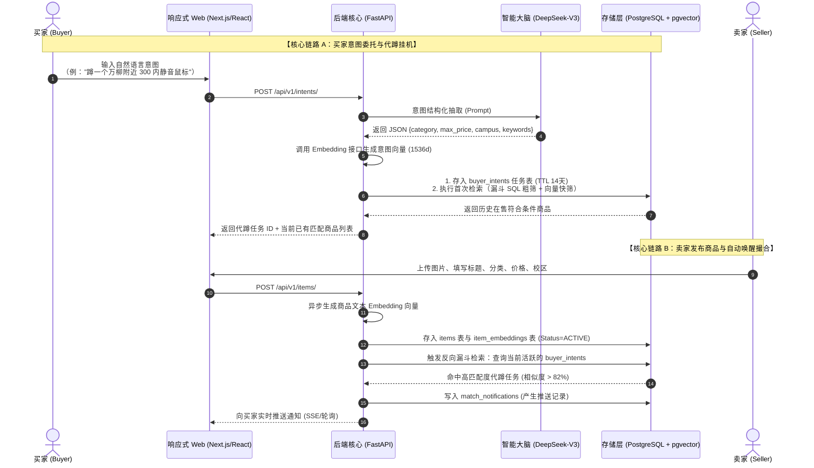

# 「燕渡」校园二手交易智能体——技术架构与实现规格书 (Technical Spec)
## Release v1.0 核心流程最小闭环版 (P0 MVP)

> **目标受众**：全栈研发团队、AI Coding Agents
>
> **发布目标**：下周上线核心 MVP（发布商品 $\to$ 浏览搜索 $\to$ 自然语言意图代蹲 $\to$ 漏斗向量撮合 $\to$ 命中推送）
>
> **核心设计原则**：先搭建核心框架、规格确定、代码与 DDL 可直接复制运行。

---

## 0. 系统端到端核心数据流 (Tracer Bullet Architecture)



---

## 1. 模块一：数据基座与存储规格 (Database & Storage Schema)

### 1.1 PostgreSQL 扩展与枚举定义
```sql
-- 启用 UUID 与 向量扩展
CREATE EXTENSION IF NOT EXISTS "uuid-ossp";
CREATE EXTENSION IF NOT EXISTS "vector";

-- 商品状态枚举
CREATE TYPE item_status_enum AS ENUM ('ACTIVE', 'RESERVED', 'SOLD', 'EXPIRED');

-- 代蹲任务状态枚举
CREATE TYPE intent_status_enum AS ENUM ('ACTIVE', 'PAUSED', 'COMPLETED', 'EXPIRED');

-- 校区枚举
CREATE TYPE campus_enum AS ENUM ('燕园校本部', '万柳学区', '医学部', '昌平新校区', '不限校区');
```

### 1.2 核心表结构 DDL

```sql
-- 1. 用户表 (核心认证实体)
CREATE TABLE users (
    id UUID PRIMARY KEY DEFAULT uuid_generate_v4(),
    student_id VARCHAR(32) NOT NULL UNIQUE,       -- 学号/教工号 (唯一标识)
    nickname VARCHAR(50) NOT NULL,                -- 昵称
    campus campus_enum NOT NULL DEFAULT '燕园校本部',
    department VARCHAR(50),                       -- 院系
    contact_wechat VARCHAR(50),                   -- 微信联系方式
    contact_phone VARCHAR(20),                    -- 电话联系方式
    created_at TIMESTAMP WITH TIME ZONE DEFAULT CURRENT_TIMESTAMP,
    updated_at TIMESTAMP WITH TIME ZONE DEFAULT CURRENT_TIMESTAMP
);

-- 2. 商品主表 (Relational Metadata)
CREATE TABLE items (
    id UUID PRIMARY KEY DEFAULT uuid_generate_v4(),
    seller_id UUID NOT NULL REFERENCES users(id) ON DELETE CASCADE,
    title VARCHAR(120) NOT NULL,                  -- 商品标题
    description TEXT,                             -- 商品详细描述
    category VARCHAR(50) NOT NULL,                -- 一级分类 (课程资料/数码3C/校园出行/宿舍电器/生活美妆)
    tags TEXT[] DEFAULT '{}',                     -- 二级标签数组 (如 ['鼠标', '无线'])
    price NUMERIC(10, 2) NOT NULL CHECK (price >= 0),
    campus campus_enum NOT NULL DEFAULT '燕园校本部',
    condition_grade VARCHAR(20) NOT NULL DEFAULT '95新', -- 全新/95新/9成新/基本可用
    images TEXT[] DEFAULT '{}',                   -- 图片 URL 数组 (前端可上传 1~3 张)
    status item_status_enum NOT NULL DEFAULT 'ACTIVE',
    created_at TIMESTAMP WITH TIME ZONE DEFAULT CURRENT_TIMESTAMP,
    expires_at TIMESTAMP WITH TIME ZONE DEFAULT (CURRENT_TIMESTAMP + INTERVAL '14 days')
);

CREATE INDEX idx_items_category_price ON items(category, price);
CREATE INDEX idx_items_status_campus ON items(status, campus);
CREATE INDEX idx_items_created_at ON items(created_at DESC);

-- 3. 商品向量表 (pgvector 稠密向量)
CREATE TABLE item_embeddings (
    item_id UUID PRIMARY KEY REFERENCES items(id) ON DELETE CASCADE,
    embedding vector(1536) NOT NULL,              -- 1536 维向量 (推荐 text-embedding-3-small 或等价)
    updated_at TIMESTAMP WITH TIME ZONE DEFAULT CURRENT_TIMESTAMP
);

-- 建立 HNSW 余弦相似度索引 (极致查询速度，内存充足下推荐)
CREATE INDEX idx_item_embeddings_hnsw ON item_embeddings
USING hnsw (embedding vector_cosine_ops)
WITH (m = 16, ef_construction = 64);

-- 4. 买家意图代蹲任务表 (Buyer Intents)
CREATE TABLE buyer_intents (
    id UUID PRIMARY KEY DEFAULT uuid_generate_v4(),
    buyer_id UUID NOT NULL REFERENCES users(id) ON DELETE CASCADE,
    raw_query TEXT NOT NULL,                      -- 买家原始自然语言 (例："蹲万柳300内自习室静音鼠标")
    parsed_category VARCHAR(50),                  -- 抽取：品类
    parsed_max_price NUMERIC(10, 2),              -- 抽取：硬性最高预算
    parsed_campus campus_enum DEFAULT '不限校区',  -- 抽取：期望校区约束
    parsed_keywords TEXT,                         -- 抽取：核心语义关键词
    query_embedding vector(1536) NOT NULL,        -- 意图语义向量
    status intent_status_enum NOT NULL DEFAULT 'ACTIVE',
    match_count INT DEFAULT 0,                    -- 已累计命中次数
    expires_at TIMESTAMP WITH TIME ZONE DEFAULT (CURRENT_TIMESTAMP + INTERVAL '14 days'),
    created_at TIMESTAMP WITH TIME ZONE DEFAULT CURRENT_TIMESTAMP
);

CREATE INDEX idx_buyer_intents_active ON buyer_intents(status, expires_at);

-- 5. 命中推送日志表 (Notifications)
CREATE TABLE match_notifications (
    id UUID PRIMARY KEY DEFAULT uuid_generate_v4(),
    buyer_id UUID NOT NULL REFERENCES users(id) ON DELETE CASCADE,
    intent_id UUID NOT NULL REFERENCES buyer_intents(id) ON DELETE CASCADE,
    item_id UUID NOT NULL REFERENCES items(id) ON DELETE CASCADE,
    similarity_score NUMERIC(5, 4) NOT NULL,      -- 余弦相似度 (如 0.8850)
    match_reason TEXT,                            -- 撮合亮点简述 (Agent 总结)
    is_read BOOLEAN NOT NULL DEFAULT FALSE,
    created_at TIMESTAMP WITH TIME ZONE DEFAULT CURRENT_TIMESTAMP,
    CONSTRAINT uq_intent_item UNIQUE(intent_id, item_id) -- 防重复对同一任务推送同一商品
);

CREATE INDEX idx_notifications_buyer_unread ON match_notifications(buyer_id, is_read, created_at DESC);
```

---

## 2. 模块二：核心 RESTful API 规格 (FastAPI 实现标准)

所有接口路由统一前缀为 `/api/v1`，遵循标准 HTTP 状态码与 JSON 响应封装。

### 2.1 数据传输模型 (Pydantic Models)

```python
# app/schemas/item.py
from pydantic import BaseModel, Field
from typing import List, Optional
from uuid import UUID
from datetime import datetime
from decimal import Decimal

class ItemBase(BaseModel):
    title: str = Field(..., max_length=120, example="Logitech MX Master 3S 静音无线鼠标")
    description: Optional[str] = Field(None, example="万柳自习室出，功能完美，附原装接收器")
    category: str = Field(..., example="数码3C")
    tags: List[str] = Field(default=[], example=["鼠标", "静音", "罗技"])
    price: Decimal = Field(..., ge=0, example=280.00)
    campus: str = Field(default="万柳学区", example="万柳学区")
    condition_grade: str = Field(default="95新", example="95新")
    images: List[str] = Field(default=[], example=["https://oss.../item1.jpg"])

class ItemCreate(ItemBase):
    seller_id: UUID

class ItemResponse(ItemBase):
    id: UUID
    seller_id: UUID
    status: str
    created_at: datetime
    expires_at: datetime

    class Config:
        from_attributes = True
```

```python
# app/schemas/intent.py
from pydantic import BaseModel, Field
from typing import Optional, List
from uuid import UUID
from datetime import datetime
from decimal import Decimal

class IntentCreate(BaseModel):
    buyer_id: UUID
    raw_query: str = Field(..., example="想收一个万柳附近 300 块以内的静音办公鼠标")

class IntentResponse(BaseModel):
    id: UUID
    buyer_id: UUID
    raw_query: str
    parsed_category: Optional[str]
    parsed_max_price: Optional[Decimal]
    parsed_campus: Optional[str]
    parsed_keywords: Optional[str]
    status: str
    match_count: int
    created_at: datetime
    expires_at: datetime

    class Config:
        from_attributes = True
```

### 2.2 核心端点清单 (Core Endpoints)

| 方法 | 路径 | 职责 | 说明 |
| :--- | :--- | :--- | :--- |
| `POST` | `/api/v1/items/` | 发布二手商品 | 写入 `items`，后台异步生成向量并触发反向撮合 |
| `GET` | `/api/v1/items/` | 瀑布流商品列表 | 支持 `category`, `campus`, `min_price`, `max_price`, `page`, `size` |
| `GET` | `/api/v1/items/{id}` | 获取商品详情 | 包含卖家联系方式（脱敏）、完整图文 |
| `PATCH` | `/api/v1/items/{id}/status` | 变更商品状态 | 卖家标记 `RESERVED` 或 `SOLD` |
| `POST` | `/api/v1/intents/` | **提交意图委托代蹲** | **调用 DeepSeek 解析意图，存入代蹲表，即刻执行首次检索** |
| `GET` | `/api/v1/intents/my` | 我的代蹲任务列表 | 查看当前正在后台持续关注商品的任务及命中统计 |
| `DELETE` | `/api/v1/intents/{id}` | 终止代蹲任务 | 买家手动结束代蹲 |
| `GET` | `/api/v1/notifications/` | 买家推送提醒列表 | 获取命中代蹲条件的商品推送卡片 |
| `PATCH` | `/api/v1/notifications/{id}/read`| 标记推送已读 | 更新 `is_read = true` |

---

## 3. 模块三：智能意图大脑与漏斗检索核心 (DeepSeek + Funnel Retrieval)

### 3.1 DeepSeek 意图解析 Agent 实现规格

使用 OpenAI 兼容 SDK 调用 DeepSeek-V3：

```python
# app/services/intent_parser.py
from openai import AsyncOpenAI
import json
import os

client = AsyncOpenAI(
    api_key=os.getenv("DEEPSEEK_API_KEY"),
    base_url="https://api.deepseek.com"
)

SYSTEM_PROMPT = """
你是一个校园二手交易意图提取专家。请将买家的自然语言需求提取为标准 JSON 格式，无多余废话。
JSON Schema 定义如下：
{
  "category": "字符串，必填：从以下枚举选择其一 ['课程资料 & 书籍', '数码 3C & 影音', '校园出行 & 运动', '宿舍生活 & 家电', '美妆服饰 & 周边', '其他']",
  "max_price": "数值或 null，买家接受的最高预算（若未提及填 null）",
  "campus": "字符串：从 ['燕园校本部', '万柳学区', '医学部', '昌平新校区', '不限校区'] 选择其一",
  "keywords": "字符串，核心语义修饰特征词，以空格分隔（如：静音 人体工学 黑色）"
}
"""

async def parse_buyer_intent(raw_text: str) -> dict:
    response = await client.chat.completions.create(
        model="deepseek-chat",
        messages=[
            {"role": "system", "content": SYSTEM_PROMPT},
            {"role": "user", "content": f"买家需求：{raw_text}"}
        ],
        response_format={"type": "json_object"},
        temperature=0.1
    )
    result = json.loads(response.choices[0].message.content)
    return result
```

### 3.2 漏斗式分级检索 SQL (Funnel Query)

当买家发起意图或新商品入库时，执行以下高性能**漏斗式分级检索**：

```sql
-- 漏斗检索实现代码：针对特定买家意图检索最匹配的在售商品
-- 传入参数：:parsed_category, :parsed_max_price, :parsed_campus, :query_embedding, :min_similarity
SELECT
    i.id,
    i.title,
    i.price,
    i.campus,
    i.condition_grade,
    i.images,
    -- 计算余弦相似度 (1 - 余弦距离)
    (1 - (ie.embedding <=> :query_embedding)) AS similarity
FROM items i
JOIN item_embeddings ie ON i.id = ie.item_id
WHERE
    -- 【第一层：零-Token 粗筛层 (SQL Metadata Filter)】
    i.status = 'ACTIVE'
    AND (:parsed_category IS NULL OR i.category = :parsed_category)
    AND (:parsed_max_price IS NULL OR i.price <= :parsed_max_price)
    AND (:parsed_campus = '不限校区' OR i.campus = :parsed_campus OR i.campus = '不限校区')

    -- 【第二层：向量相似度快筛层 (Dense Vector HNSW Search)】
    AND (1 - (ie.embedding <=> :query_embedding)) >= :min_similarity -- 推荐阈值 0.82
ORDER BY similarity DESC
LIMIT 10;
```

---

## 4. 模块四：响应式 Web 前端工程 (Responsive Web UI)

采用 **Vite + React (或 Next.js) + Tailwind CSS**，优先适配手机与电脑双端浏览器。

### 4.1 页面结构规划 (P0 MVP)

```text
/ (首页 - 瀑布流商品大厅)
├── 顶部导航 (Navbar)：校园标识、当前校区切换、发布按钮
├── 快捷分类 Tag 栏 (全部 / 数码3C / 课程书籍 / 校园出行...)
├── 悬浮/吸顶【意图代蹲输入栏】(Hero Intent Input)
│   └── "输入一句话委托燕渡持续关注，例如：万柳 300 内自习室静音鼠标"
└── 响应式商品卡片瀑布流 (Responsive Masonry Cards)
    ├── 封面图 + 成色标签
    ├── 标题 + 价格 (醒目红色/活力色)
    └── 校区位置 + 发布时间标签

/intents (我的代蹲任务中心)
├── 活跃代蹲列表 (卡片展示：原始描述、解析条件、已关注天数)
└── 实时命中推送流 (展示匹配商品卡片 + 相似度百分比 + 一键私信)

/publish (卖家发布页)
└── 极简发布表单 (上传图片 1~3 张、标题、一级分类下拉、价格、校区、成色、微信/电话)
```

---

## 5. 下周上线：端到端开发与验收清单 (Execution Checklist)

开发团队/Agent 依此顺序执行验收：

- [ ] **Step 1: 数据库就绪**
  - 在 PostgreSQL 16 执行 `CREATE EXTENSION vector;` 及第 1 节的 DDL 语句。
  - 验证 `\d items`, `\d item_embeddings`, `\d buyer_intents` 结构正常。
- [ ] **Step 2: 基础 FastAPI 骨架搭建**
  - 配置 SQLAlchemy 2.0 (asyncpg) 数据库连接。
  - 实现 `POST /api/v1/items/` 与 `GET /api/v1/items/`，确认商品可存可查。
- [ ] **Step 3: 接入 DeepSeek 意图解析**
  - 配置 `DEEPSEEK_API_KEY`，单元测试 `parse_buyer_intent()` 能将 *"蹲万柳 300 内显示器"* 正确转为 JSON。
  - 整合文本 Embedding 生成函数，将向量写入 `item_embeddings` 与 `buyer_intents`。
- [ ] **Step 4: 漏斗检索闭环打通**
  - 测试端到端：先挂起一个意图任务，随后以卖家身份发布一条符合条件的商品。
  - 验证后台是否自动检索命中，并在 `match_notifications` 表中产生记录。
- [ ] **Step 5: 前端页面联调**
  - 实现首页商品流展示。
  - 实现首页「意图代蹲输入框」，提交后即时提示 *"燕渡智能体已开始为您全天候代蹲！"*。
  - 实现推送通知弹窗/红点提示。
